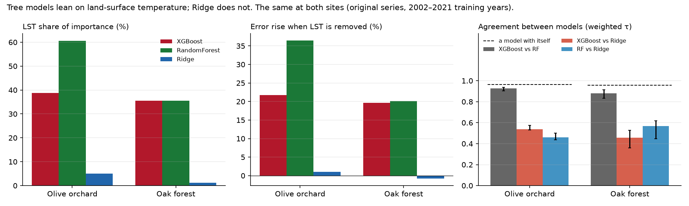
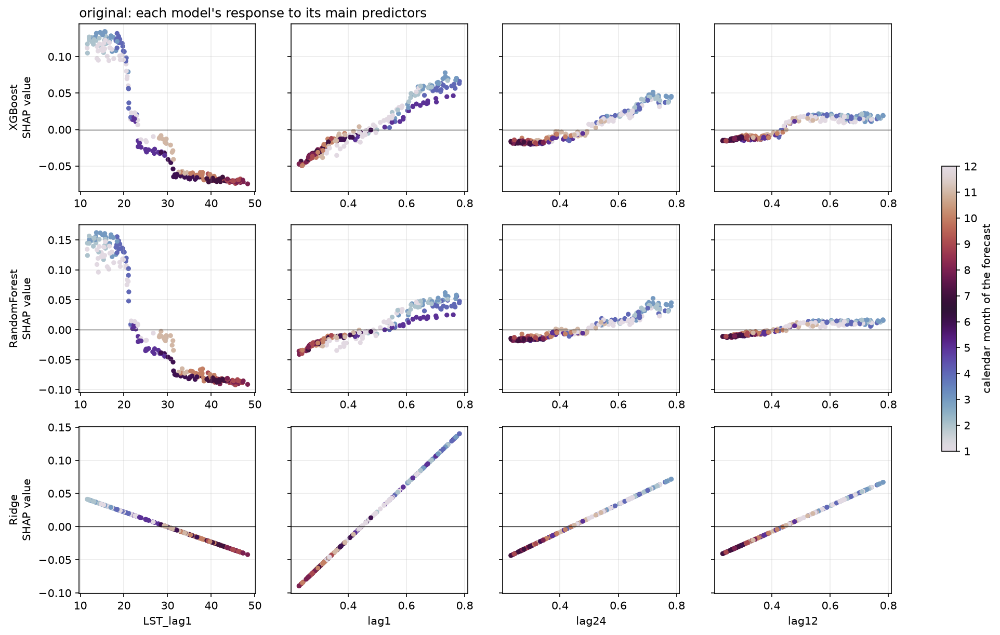

# olive-ndvi-xai-comparison

**Do different machine-learning models explain the same NDVI forecast the same way, and does
the answer change with the vegetation?**

Five models, XGBoost, Random Forest, a support vector machine for regression (SVR), a small
neural network (MLP) and Ridge regression, forecast next month's NDVI from identical inputs at
a hand-delineated olive orchard in Jendouba, Tunisia, on the series and on its seasonal and
trend components. Their explanations are compared with each other, each against how much it
changes when the same model is simply refitted, and with SARIMAX, an interpretable seasonal
ARIMA specified and explained before the other models. The study is about explanations, not
about which model forecasts best.

This is the **olive half** of a two-site study. The forest half is
[`forest-ndvi-xai-comparison`](https://github.com/ilyes-khayati/forest-ndvi-xai-comparison).
Notebooks 01–05 run the same code at both sites, so any difference between them comes from the
vegetation, not from the pipeline. It builds on `olive-ndvi-wavelet-xai`, a frozen reproduction
of the framework.



## Findings

**Olive, five models and SARIMAX (notebooks 04–05):**

- **All five models agree with SARIMAX on direction.** A warmer previous month lowers the
  forecast and a wetter SPEI-6 raises it, as SARIMAX's significant coefficients say
  (−0.0044 NDVI per °C, p = 0.002; +0.013 per SPEI unit, p < 0.001).
- **They agree on what matters, not on how much.** All five rank last month's LST, last
  month's NDVI and NDVI two years earlier first. LST's share of importance runs from 76% and
  61% (Random Forest, XGBoost) to 17% (MLP, SVR) and 9% (Ridge).
- **Two families of explanation.** Trees agree with trees (τ 0.93), MLP with SVR (0.92) and both
  with Ridge (0.65–0.72); trees with the others only 0.46–0.61, beyond refitting noise.
- **SPEI matters little to every model** (1–3%), though significant in SARIMAX: a real but
  four times smaller effect than LST's, ranked the same way by all six models.
- **The trend component is explained by its own past** (96–100%), and there the explanations
  are unstable.

**Olive and forest, three models (shared protocol):**

- **The two tree models agree with each other; both disagree with Ridge.** Weighted Kendall τ
  between importance rankings is 0.93 for XGBoost vs Random Forest, and 0.46–0.54 for tree vs
  Ridge. Each model agrees with itself at 0.96 or more when refitted with other seeds.
- **The disagreement is land-surface temperature (LST).** A linear screen rejected LST, and
  Ridge gives it 5% of its importance. The tree models give it 39–61%, and refitting them
  without LST raises their error by 22–36%.
- **In the orchard, the trees use the weather in LST, not just the season.** Replacing LST by
  its monthly climatology recovers only 18–38% of its value. The trees' response steps down
  near 21 °C and again near 31 °C: heat and dry-season limits.
- **In the forest, the same predictor is a seasonal clock**, with a threshold near 15 °C. Same
  models, same pipeline, opposite mechanism.

| Test 2022–2024 | XGBoost | Random Forest | Ridge | Climatology | Persistence |
|---|---|---|---|---|---|
| R² | 0.88 | 0.86 | 0.86 | 0.77 | 0.62 |
| MAE (NDVI) | 0.037 | 0.037 | 0.047 | 0.047 | 0.070 |



*How each model responds to its main predictors. The trees turn LST into steps near 21 °C and
31 °C; Ridge can only draw a straight line.*

## Study area

`olive-jendouba-polygon.geojson` covers 0.644 km², drawn by hand on high-resolution imagery
where the olive planting grid is visible.

- **NDVI** (MODIS, 250 m): about 10 pixels, so the orchard is resolved.
- **LST** (MODIS, 1 km): 0.64 of one pixel, so LST includes the surroundings.

## Notebooks

| | Notebook | What it does |
|---|---|---|
| 01 | data acquisition | polygon extraction, per-pixel quality mask, SPEI 1–48 months |
| 02 | wavelet decomposition | discrete Meyer at native cadence; look-ahead of the trend measured |
| 03 | feature derivation | every predictor justified from evidence; drought memory |
| 04 | model training | SARIMAX specified and explained first; five models; accuracy as context |
| 05 | attribution | explanations across the five models, and against SARIMAX |
| 06 | selection | stratified selection, and Ridge weights as a neutral selector |
| 07 | rashomon | explanations across equally good configurations |
| 08 | synthetic ground truth | which explanation recovers known importances |

Notebooks 01–05 follow the shared two-site protocol, described in the
[forest README](https://github.com/ilyes-khayati/forest-ndvi-xai-comparison#protocol); SARIMAX,
SVR and the MLP have so far been added at the olive site only. Notebooks 06–08 are olive-only
extensions on XGBoost, Random Forest and Ridge; all saved outputs come from the current
protocol. Every notebook explains its choices with references and ends with its limitations;
the full bibliography is in [`docs/references.md`](docs/references.md).

## Running it

```sh
git clone https://github.com/ilyes-khayati/olive-ndvi-xai-comparison.git
cd olive-ndvi-xai-comparison
python3.12 -m venv .venv && source .venv/bin/activate
pip install -r requirements.txt
python -m ipykernel install --user --name olive-xai
```

Open the notebooks with the `olive-xai` kernel and run them in order from 02. The extracted
series in `data/raw/` are committed, so no Earth Engine account is needed. Notebook 01
re-extracts them and needs one:

```sh
earthengine authenticate
export EE_PROJECT=<your Earth Engine project id>
```

## Limitations

Each notebook lists its own; the main ones:

- **Explanations describe models, not the orchard.** What a model relies on is not thereby a
  cause of NDVI.
- **Two-sided components.** The wavelet filter uses later months (measured in notebook 02), so
  the seasonal and trend branches describe the components, not a real-time forecast.
- **Composite timing.** A MODIS composite is dated by the first day of its window, so part of
  last month's NDVI can come from the month being forecast (measured in notebook 02).
- **Coarse climate.** LST covers 0.64 of one 1 km pixel and SPEI one 0.5° cell, yet LST is the
  predictor the models rely on most.
- **SARIMAX is a sound reference on the original series only**; on the components it is poorly
  behaved (notebook 04).
- **One orchard.** The result is a case study until it is repeated on other orchards.

## Licence

Built with scikit-learn (Pedregosa et al., 2011), statsmodels (Seabold and Perktold,
2010), XGBoost, SHAP and PyWavelets.

Code under the MIT licence (see `LICENSE`). The MODIS, SPEI and WorldCover data keep their own terms.

## Author

Ilyes Khayati. Data: MODIS MOD13Q1 and MOD11A2 (NASA LP DAAC, via Google Earth Engine),
SPEIbase v2.11, ESA WorldCover v200.
